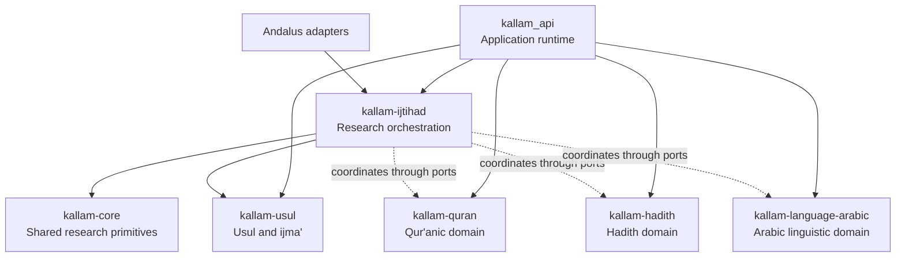

# Kallam Module Boundaries

Each source domain owns its concepts and evidence constraints. The Ijtihad layer coordinates research without absorbing those domains.

## Domain ownership

| Module | Owns |
|---|---|
| kallam-core | Shared research lifecycle, evidence provenance, planning and reports |
| kallam-quran | Qur'anic text, surah/ayah references, editions, orthography, Qira'at, riwayah, tariq, tafsir and source provenance |
| kallam-language-arabic | General Arabic text, morphology, syntax/Naḥw, I'rab, lexicon, semantics and Balaghah |
| kallam-hadith | Hadith corpus, isnad, narrators/rijal, matn, takhrij, grading and hadith provenance |
| kallam-usul | Usul al-Fiqh, ijma', ijma' al-Sahabah, qiyas, istihsan, istishab, maslahah, maqasid and qawa'id |
| kallam-ijtihad | Research protocol, evidence orchestration, methodology profiles, comparative analysis and Tarjih |
| Andalus integrations | Runtime, retrieval and agent adapters |

## Collaboration model

Dashed relationships are orchestration boundaries, not mandatory compile-time dependencies. Qur'anic, hadith, Arabic and usul modules remain independently usable. Avoid circular dependencies.

## Ijma' and Companion-consensus boundary

An ijma' record is a research claim with explicit epistemic state. Kallam distinguishes a source reporting agreement, individual Companion positions, explicit versus tacit claims, evidence of dissent, the scope of a dissent search, methodology-specific assessment and scholar review.

DISSENT_NOT_IDENTIFIED_WITHIN_SCOPE means only that no dissent was located in the declared scope. It is not proof that dissent never existed. VERIFIED_WITHIN_METHODOLOGY requires an explicit methodology profile and attributable scholar reviewer.

## General rules

1. Domain modules remain provider-independent and have no Quarkus, Andalus, database or model-vendor dependency.
2. Source adapters preserve stable locators, edition/release identity and verification state.
3. AI synthesis is not primary-source evidence.
4. Retrieval scores do not authenticate sources.
5. Methodology profiles are explicit and versioned.
6. Final scholarly judgment remains with the qualified human scholar.
