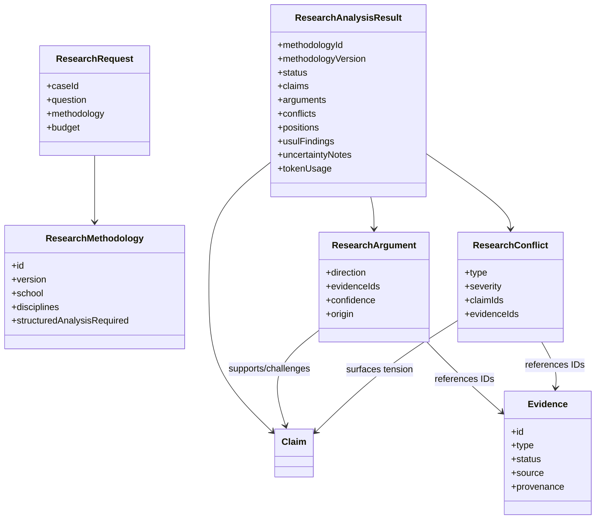
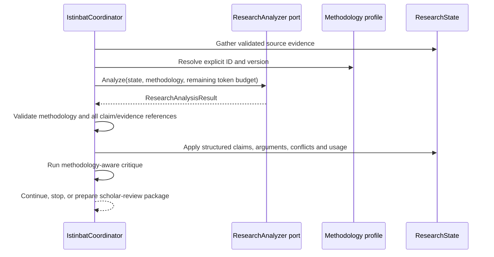

# P1.1 — Structured Scholarly Analysis

## Purpose

Introduce a framework-independent contract for structured analysis of a Kallam research state. This contract is the boundary between Kallam's scholarly domain and a replaceable reasoning adapter (Andalus inference runtime, another model runtime, or a deterministic engine).

This milestone establishes the domain contract and validation boundary. It does not claim that a production LLM analysis adapter is already implemented.

## Domain model

## Contracts and invariants

- A request carries an explicit methodology ID and version. Legacy constructors use the explicit `unspecified@0` profile; no madhhab is inferred.
- The analysis result must return the same methodology ID and version as the request.
- Analysis may refer only to evidence already present in the research state. It cannot add or mutate source evidence.
- Every argument must reference a claim in the same result. Every claim/evidence reference in a conflict must resolve.
- Argument origin is explicit: model inference, scholar annotation, or deterministic rule.
- Arguments and conflicts surface reasoning and tensions; they do not perform automatic tarjih or resolve scholarly disagreement.
- Confidence is a declared assessment, not a probability guarantee or proof of correctness.
- Uncertainty notes are retained as uncertainty annotations and are not silently converted into factual unresolved questions.
- Token usage is provider-reported. The coordinator passes the remaining reasoning-token budget and rejects results that exceed it. No text-length token estimates are used.
- The safe default analyzer returns `NOT_CONFIGURED` with no invented claims or arguments.
- A methodology that requires structured analysis cannot be marked ready for scholar review while the analyzer is unconfigured or incomplete.
- The report retains the structured result and continues to require scholar judgment.

## Analysis cycle

## Deliberate limitations

- No default prompt or model call is embedded in the domain core.
- The default analyzer is intentionally non-generative; deployment wiring must provide an adapter.
- This contract does not define madhhab-specific legal reasoning rules or automatically rank evidence.
- Source authenticity, isnad grading, takhrij, and textual verification remain separate specialist/retrieval responsibilities.
- The current analysis result is a structured analysis snapshot for the accumulated state. Adapter implementations should include the evidence IDs supporting each assertion and should preserve uncertainty rather than fill gaps.

## Verification

Tests cover methodology-version mismatch, unknown evidence references, unknown claim references, authoritative token usage, remaining token budgets across iterative rounds, safe default behavior, and report preservation.