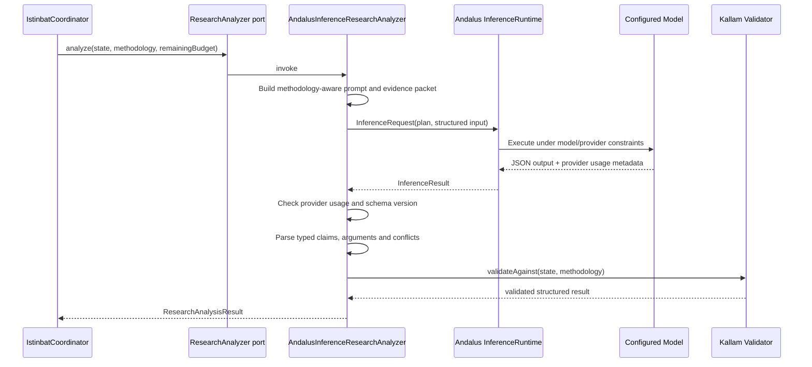

# P1.2 — Andalus Reasoning Adapter

## Purpose

P1.2 connects Kallam's `ResearchAnalyzer` domain port to the optional Andalus inference runtime. It does not move scholarly methodology, evidence validation, or research orchestration into Andalus.

- **Kallam core** owns methodology identity/version, evidence and claim contracts, argument/conflict semantics, token-budget accounting, and scholar-review boundaries.
- **Kallam Andalus integration** owns the adapter, prompt assembly, response parsing, and mapping to/from Andalus inference requests.
- **Andalus** owns model/provider routing and inference execution.
- **The retrieval layer** remains the only owner of source evidence acquisition. Model output can reference evidence IDs already in the research state; it cannot add evidence.

## Runtime flow

## Trust and validation boundaries

1. The request includes the explicit methodology ID, version, school, and disciplines. No madhhab is inferred when the request is unspecified.
2. The model is instructed not to issue a fatwa, perform tarjih, or claim scholarly authority.
3. The response must include the supported schema version and the exact methodology ID/version used for the request.
4. The parser rejects unknown schema fields, invalid enums, malformed JSON, and invalid value types.
5. Arguments and conflicts must reference known claim IDs and evidence IDs. `ResearchAnalysisResult.validateAgainst` performs the authoritative state-aware validation.
6. Model-provided source records, citations, isnad grades, or new evidence are not accepted as evidence. Those belong to Kallam retrieval and specialist verification.
7. The adapter never upgrades model output to a final ruling. `COMPLETE` means only that the structured analysis payload is complete for scholar review.

## Token accounting

Andalus `InferenceUsage` reports input and output tokens. The adapter reads reasoning-token usage only from provider-supplied `InferenceResult.metadata.reasoningTokens`. It does not estimate reasoning usage from text length or relabel output tokens as reasoning tokens.

If the provider does not report reasoning-token usage, the adapter returns a `PARTIAL` result and does not accept the model's claims or arguments. If provider-reported reasoning usage exceeds the remaining Kallam budget, the output is rejected. The request also sets the remaining budget as the maximum generated-token allowance.

A future provider adapter may map native reasoning-token metadata into this contract. Until then, providers without that metadata cannot produce a complete Kallam analysis through this adapter.

## Failure behavior

- Runtime exception, timeout, unavailable provider, or unsuccessful inference result: return `PARTIAL` with an explicit uncertainty note and no accepted claims/arguments.
- Malformed JSON, unsupported schema version, methodology mismatch, unknown fields, invalid types/enums, or invalid evidence references: reject the output and return `PARTIAL` with no accepted claims/arguments.
- No remaining budget: do not invoke Andalus.
- Missing provider reasoning-token metadata: do not accept the generated analysis as complete.
- The coordinator and domain core remain responsible for the final research stop conditions and scholar-review status.

## Configuration and dependency boundary

The adapter lives in the optional `kallam-andalus-integration` Maven module, activated through the root `andalus-runtime` profile. The default Kallam reactor and domain core do not depend on Andalus or Jackson.

Applications explicitly configure an `InferenceRuntime`, model ID, and adapter instance, then inject the adapter as `ResearchAnalyzer`. The adapter does not create a global runtime, select a provider, or embed credentials.

## Next validation work

The optional profile must be compiled and tested in an environment that can resolve the configured Andalus Maven artifacts. CI for the default reactor alone does not prove this integration profile. Production rollout should additionally verify provider-specific reasoning-token metadata, model JSON-mode behavior, latency/cancellation semantics, and prompt/schema compatibility against the selected model.
