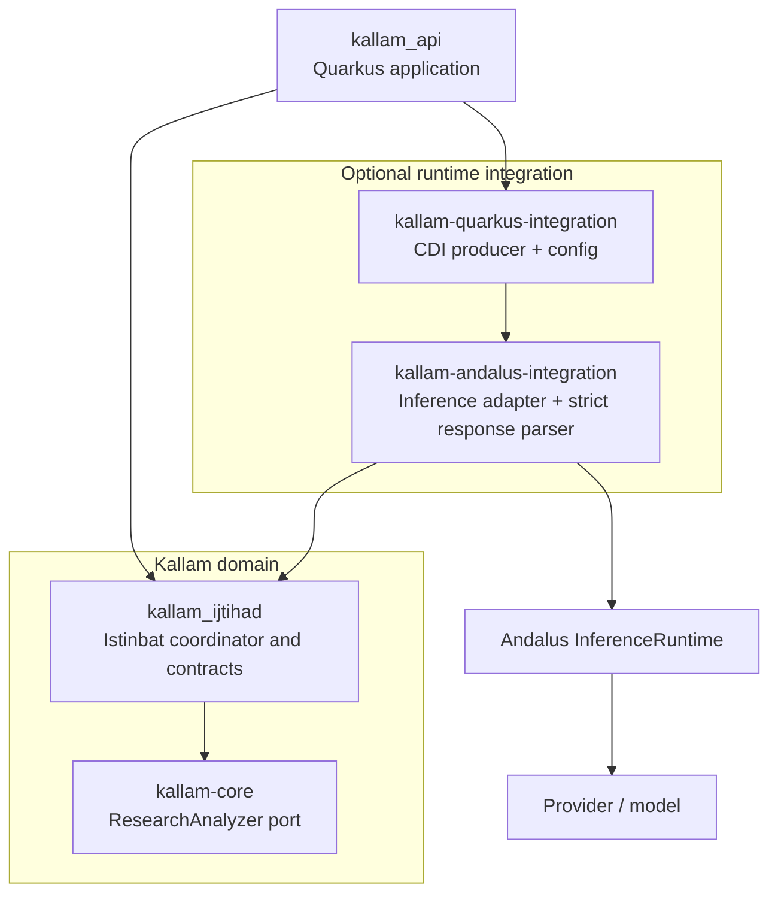

# P1.3 — Provider Conformance and Quarkus Runtime Integration

## Purpose

P1.3 makes the P1.2 adapter an explicit, opt-in Quarkus integration and defines a provider conformance contract. Kallam core remains a plain Java domain library.

## Module boundaries



- `kallam-core` and `kallam_ijtihad` do not depend on Quarkus or Andalus.
- `kallam-andalus-integration` depends only on the Andalus harness inference contract and Kallam domain contracts. It does not depend on Andalus RAG/runtime modules that it does not call.
- `kallam-quarkus-integration` contains CDI and MicroProfile Config wiring only.
- Both optional modules are included by the root `andalus-runtime` Maven profile. The API depends on the Quarkus integration module only in that profile.

## Provider conformance contract

An inference result is eligible for Kallam structured-analysis parsing only when all of these conditions hold:

| Contract field | Requirement |
|---|---|
| `InferenceResult.status` | `COMPLETED` |
| `InferenceResult.modelId` | Present and nonblank |
| `InferenceResult.providerId` | Present and nonblank |
| `InferenceUsage.inputTokens` | Nonnegative and representable as Kallam's integer usage |
| `InferenceUsage.outputTokens` | Nonnegative and representable as Kallam's integer usage |
| `InferenceResult.metadata["kallam.usage.reasoningTokens"]` | Present, integral, nonnegative, and representable as an integer |
| Output | Strict JSON using `kallam-research-analysis-v1` |

The generic Andalus `InferenceUsage` contract currently exposes input/output/total usage, but not a dedicated reasoning-token field. The namespaced metadata key above is therefore the explicit interoperability contract between a provider adapter and Kallam. Provider adapters should map their native reasoning usage into this key and should retain provider/model identity.

If a provider does not expose reasoning-token usage, the analyzer returns `PARTIAL` without accepting model claims or arguments. It does not estimate reasoning usage from output length or infer it from total/output tokens.

## Budget semantics

The Kallam reasoning-token budget and the model's generated-output budget are different controls:

- The inference request sets a bounded JSON-output allowance independently of reasoning usage.
- The remaining Kallam reasoning budget is passed as `kallam.reasoningTokenBudget` in inference constraint attributes and plan metadata.
- A provider integration should map this value to a native reasoning-token limit where its model supports one.
- Kallam validates the provider-reported reasoning-token usage after execution and rejects output that exceeds the remaining budget.

The generic Andalus harness does not itself guarantee enforcement of the Kallam-specific reasoning budget. A provider that cannot enforce the budget before generation is still subject to Kallam's post-execution rejection rule.

## Timeout and cancellation

The adapter waits only up to the configured timeout. On timeout or thread interruption it requests cancellation of the returned `CompletableFuture`. Actual cancellation of an in-flight provider request depends on the runtime/provider adapter propagating cancellation to its transport. Provider retries, if enabled, belong in the Andalus provider/runtime layer so Kallam does not multiply retries or duplicate inference calls.

## Quarkus composition and safe defaults

The API's existing `CoreDomainBeans` producer continues to supply `DefaultResearchAnalyzer` unless the build property `kallam.reasoning.enabled=true` is set.

When the optional profile is built and reasoning is enabled, `AndalusResearchAnalyzerProducer` supplies the Andalus-backed `ResearchAnalyzer`. It uses one CDI `InferenceRuntime` bean when present. Otherwise it composes `DefaultInferenceRuntime` from CDI `InferenceProviderAdapter` beans that support the configured model. Startup fails clearly if:
- multiple CDI `InferenceRuntime` beans are ambiguous;
- no runtime bean and no compatible provider adapter are available;
- multiple provider adapters support the model and no explicit provider ID was selected;
- `kallam.reasoning.model-id` is blank; or
- the configured timeout is not positive.

There is no silent fallback from an explicitly enabled model-backed configuration to the unconfigured analyzer.

Configuration in `kallam_api/src/main/resources/application.properties`:

```properties
kallam.reasoning.enabled=${KALLAM_REASONING_ENABLED:false}
kallam.reasoning.model-id=${KALLAM_REASONING_MODEL_ID:}
kallam.reasoning.provider-id=${KALLAM_REASONING_PROVIDER_ID:}
kallam.reasoning.timeout=${KALLAM_REASONING_TIMEOUT:PT45S}
```

These are Quarkus build-time selection properties for the conditional CDI producers. Set them before packaging the Quarkus application.

Example:

```bash
KALLAM_REASONING_ENABLED=true \
KALLAM_REASONING_MODEL_ID=<configured-model-id> \
KALLAM_REASONING_PROVIDER_ID=<optional-provider-id> \
KALLAM_REASONING_TIMEOUT=PT45S \
mvn -Pandalus-runtime -s .mvn/settings.xml -B clean verify
```

A provider module must contribute CDI `InferenceProviderAdapter` beans or a single configured `InferenceRuntime` bean, together with provider credentials/configuration. When more than one provider supports the selected model, set `KALLAM_REASONING_PROVIDER_ID` to make routing deterministic. Kallam does not create credentials or choose a provider implicitly.

## CI verification

The default Maven reactor remains a separate CI job. A second job runs the optional profile using the configured GitHub Packages read token. This is intentional: a passing default build must not be mistaken for proof that the external Andalus integration compiles.

If the optional job cannot resolve `tech.kayys.andalus:andalus-harness`, the package publication/permissions must be fixed before claiming the integration is verified.

## Safety boundary

The provider adapter is an inference transport, not a scholarly authority. It cannot create source evidence, authenticate hadith, grade isnad, choose a madhhab, perform tarjih, or issue a fatwa. All accepted model analysis remains subject to Kallam's state validation and qualified scholar review.
