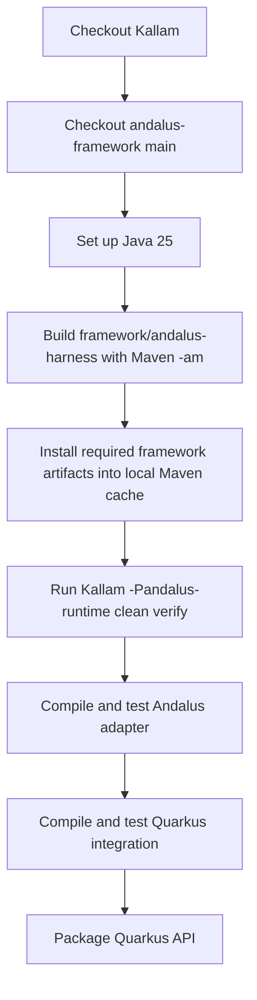

# P1.4 — Runtime Build and Provider Conformance

## Why this milestone exists

P1.3 introduced an optional dependency on `tech.kayys.andalus:andalus-inference-api:0.0.1`. The default Kallam reactor passes, but the optional profile cannot resolve that artifact from Maven Central or the configured GitHub Packages repositories.

The upstream source of truth is the public `andalus-ai/andalus-framework` repository. Its root Maven project is `andalus-framework-build:0.0.1`; the harness module is `framework/andalus-inference-api`. The dependency is currently not reliably published as a package consumable by Kallam CI.

Until publication is reliable, CI builds and installs the exact harness reactor dependency from source before verifying Kallam's optional profile. This tests the actual source API used by Kallam without committing binaries, vendoring source, or coupling Kallam's domain modules to the framework repository.

## CI sequence



The build command is:

```bash
mvn -f andalus-framework/pom.xml \
  -pl framework/andalus-harness -am \
  -DskipTests -B -ntp install
```

Then:

```bash
mvn -Pandalus-runtime -s .mvn/settings.xml -B -ntp clean verify
```

The first command uses Maven's reactor dependency graph (`-am`) to build the harness and its required framework modules. `-DskipTests` still compiles production code and test sources; it skips executing the framework's tests in this focused dependency build. Kallam's own optional integration tests execute in the second command.

The first source-build attempt exposed a second dependency-publication gap: `andalus-embedding`, which is pulled in by `andalus-knowledge` and then by `andalus-harness`, depends on unpublished Gamelan snapshot artifacts (`gamelan-plugin-spi`, `gamelan-sdk-executor-core`) and Aqli snapshot artifacts (`aqli-sdk`, `aqli-sdk-core`, `aqli-spi-inference`). The source-build job currently fails before it reaches the harness module. Checking out only `andalus-framework` is therefore insufficient; the upstream build must either publish these dependencies or the harness/inference contracts must be split into a smaller module without the knowledge/embedding stack.

## Provider conformance boundary

This milestone does not invent a production provider implementation inside Kallam. The responsibilities remain:

- Andalus owns concrete model/provider adapters and maps provider-native usage to the inference contract.
- Kallam owns scholarly prompt construction, schema validation, evidence-reference validation, methodology alignment, and the scholar-review boundary.
- Kallam accepts reasoning-token usage only from the explicit `kallam.usage.reasoningTokens` metadata contract. Missing or invalid usage yields a partial analysis, not a fabricated accounting value.

The current Andalus framework exposes `InferenceProviderAdapter` as an SPI, but repository inspection did not find a concrete implementation of that SPI in the framework. Existing provider implementations in the separate Andalus runtime use a different provider interface. A future provider bridge should be implemented and tested in the Andalus provider/runtime repository, rather than leaking provider-specific transport into Kallam core. The current source-build CI is intentionally left failing rather than masking this dependency gap with `continue-on-error`.

## Publication follow-up

Once Andalus publishes `andalus-harness:0.0.1` and its transitive framework artifacts reliably to GitHub Packages, CI can switch back to consuming the package. The source-build job is intentionally explicit so that package publication failures are not mistaken for Kallam source/test failures.

## Acceptance criteria

- The default Kallam build remains independent of Andalus artifacts.
- The optional integration job builds the actual upstream harness source and its reactor dependencies.
- The optional Kallam profile compiles the Andalus adapter, CDI module, and Quarkus API.
- Kallam tests verify strict structured output, evidence IDs, methodology identity, provider/model identity, reasoning usage, timeout behavior, and opt-in runtime selection.
- No production inference provider or scholar-facing ruling capability is claimed until a concrete Andalus adapter passes provider conformance.
