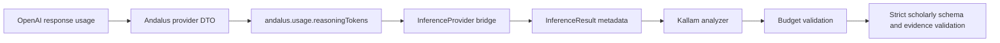

# P1.5 — Standardize Provider Usage Metadata

## Decision

Provider usage is a framework contract, not a Kallam-specific provider convention. Kallam now consumes the shared Andalus inference metadata keys:

- `andalus.usage.reasoningTokens`: exact provider-reported reasoning-token count.
- `andalus.reasoningTokenBudget`: requested reasoning-token budget forwarded through inference constraints.

The old `kallam.usage.reasoningTokens` result key remains accepted as a compatibility fallback for previously integrated adapters. New providers must emit the framework key.

## Flow

## Safety rules

- Never derive reasoning-token counts from completion/output-token totals.
- Missing reasoning usage makes the Kallam analysis partial; no model claims are accepted.
- Usage above the remaining Kallam budget rejects the model output.
- Provider and model identity must be present.
- Kallam remains responsible for methodology alignment, schema validation, evidence-ID validation, and scholar review.

## Scope

The Andalus framework bridge and provider implementations own generic execution and provider-reported usage. Kallam only consumes the shared contract. This prevents the framework and provider plugins from depending on Kallam domain terminology.

## Integration boundary cleanup

The P1.4 optional build exposed older Andalus agent and RAG adapters in `kallam-andalus-integration` that import legacy packages (`tech.kayys.andalus.agent`, `tech.kayys.andalus.execution`, `tech.kayys.andalus.runtime`, and `tech.kayys.andalus.rag.core`) not present in the current `andalus-framework` API.

Those source files and their old RAG test have been moved under:
- `kallam-andalus-integration/src/legacy/java`
- `kallam-andalus-integration/src/legacy-test/java`

They are retained as migration references but are not compiled or packaged. The active `kallam-andalus-integration` module now contains the lightweight inference adapter only. The legacy agent and RAG capabilities must be reimplemented against the current Andalus agent and RAG contracts in separate adapters before they are re-enabled. This avoids restoring the full harness dependency merely to satisfy stale imports.

## Quarkus runtime composition

The optional `kallam-quarkus-integration` module now includes Andalus's `andalus-inference-provider-bridge-quarkus`. At Quarkus startup, that module discovers CDI `InferenceProvider` beans and composes the single `InferenceRuntime` consumed by Kallam's analyzer producer.

The bridge resolves provider identity from each provider's advertised `ModelInfo.provider()`; it rejects ambiguous or missing identities rather than guessing. If no concrete provider bean is installed, the runtime reports provider-unavailable and Kallam remains partial/fail-closed. A concrete provider plugin must therefore be packaged as a CDI bean in the application for model-backed research to run.
