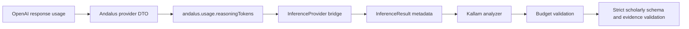

# P1.5 — Standardize Provider Usage Metadata

## Decision

Provider usage is a framework contract, not a Kallam-specific provider convention. Kallam now consumes the shared Andalus inference metadata keys:

- `andalus.usage.reasoningTokens`: exact provider-reported reasoning-token count.
- `andalus.reasoningTokenBudget`: requested reasoning-token budget forwarded through inference constraints.

The old `kallam.usage.reasoningTokens` result key remains accepted as a compatibility fallback for previously integrated adapters. New providers must emit the framework key.

## Flow

## Safety rules

- Never derive reasoning-token counts from completion/output-token totals.
- Missing reasoning usage makes the Kallam analysis partial; no model claims are accepted.
- Usage above the remaining Kallam budget rejects the model output.
- Provider and model identity must be present.
- Kallam remains responsible for methodology alignment, schema validation, evidence-ID validation, and scholar review.

## Scope

The Andalus framework bridge and provider implementations own generic execution and provider-reported usage. Kallam only consumes the shared contract. This prevents the framework and provider plugins from depending on Kallam domain terminology.
