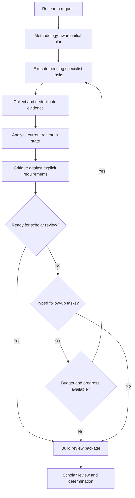

# P1 — Iterative Istinbāṭ Research Engine

## Goal

Turn the initial retrieval-and-critique skeleton into a bounded, critique-driven research cycle. Kallam remains the owner of scholarly workflow and methodology; Andalus remains an execution/inference adapter. The cycle prepares material for qualified scholarly review and does not issue autonomous fatwas or final rulings.

## Research cycle

## Contracts

- `FollowUpResearchTask` is an executable, typed task. It identifies the specialist port, objective, query, retrieval depth, primary-source constraint and reason for the follow-up.
- `ResearchCritique.followUpTasks` carries actionable work. `requiredResearch` remains human-readable explanatory text and is not parsed into executable tasks.
- `ResearchRequirement` is supplied by the selected methodology/profile. The generic critic does not assume that every question requires both Qur'an and Hadith evidence.
- `ResearchPlan.ResearchTask` keeps task rationale and supports conversion from a typed follow-up.
- `ResearchState.toolCalls` counts specialist invocations. Evidence volume is measured separately by `evidence().size()`; repeated evidence IDs are deduplicated.
- The coordinator executes the initial plan once. Later rounds execute only the follow-up tasks emitted by the immediately preceding critique.

## Stop conditions and budgets

The coordinator stops when any of the following holds:

1. The maximum round count is reached.
2. The maximum specialist invocation count is reached.
3. The evidence-item cap is reached.
4. The elapsed execution-time cap is reached.
5. The critique is ready for scholar review.
6. The critique has no typed follow-up tasks.
7. A round produces no new evidence.

The plan carries a reasoning-token budget for inference adapters. This P1 core change does **not** claim to enforce model token consumption: the current `ResearchAnalyzer` contract does not return measured usage. Enforce that budget when the inference adapter exposes authoritative usage metadata; do not estimate it from character counts.

## Epistemic and methodology safeguards

- Evidence type and source status must come from validated source metadata, not from the requested specialist or query.
- A configured requirement means the selected methodology expects that evidence class; it is not a universal requirement across all madhhabs or disciplines.
- Evidence presence is a minimal completeness signal, not proof of authenticity, legal weight, or correctness.
- A package marked ready is ready for scholar review only. It is not a ruling or an endorsement of an argument.
- Missing requirements remain explicit; unavailable specialists are not silently treated as satisfied.
- Scholar annotations and authoritative corpus updates remain subject to the separate review workflow.

## P1 verification

The core tests cover typed follow-up creation, a second round driven by critique rather than replay of the first plan, specialist invocation accounting independent of evidence count, and termination when no new evidence is produced.

## Next work

- Add an analysis result contract that returns structured claims, supporting/contradicting evidence links, conflict sets, uncertainty and measured token usage.
- Bind analysis to the selected methodology version and research disciplines.
- Add source-validation policies and evidence authenticity checks at the retrieval boundary.
- Add API-level tests for session projection, revision sequencing and authenticated scholar identity.
- Add integration tests when the required Andalus runtime artifacts are published and available.
