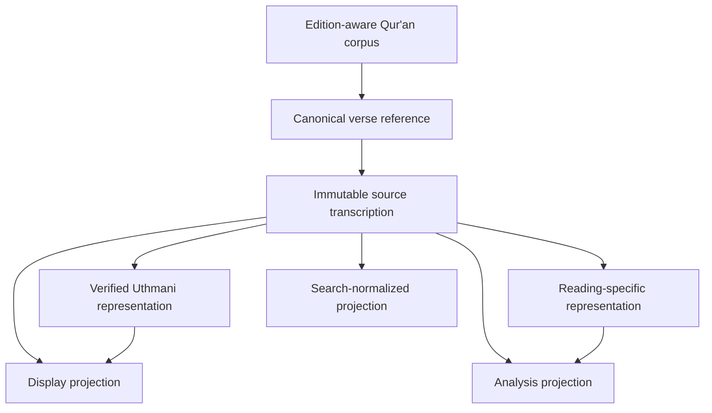

# QA0–QA1 — Qur'anic Text Domain and Source Foundation

## Objective

Establish a provider-independent, edition-aware foundation for Qur'anic text before implementing morphology, syntax, I'rab, semantics, Balaghah or Qira'at comparison.

This milestone defines domain contracts and source-preservation rules. It does not claim to ship a complete Qur'anic corpus or a validated Qira'at database.

## Scope

- Canonical surah/ayah coordinates.
- Edition-specific text identity.
- Explicit text representation kinds.
- Immutable source transcription.
- Provenance for derived representations.
- A read port for source-attested verse text.
- Domain validation tests.

## Identity boundaries

A `VerseReference` identifies canonical coordinates (surah and ayah). It is not a substitute for an edition identifier or a source locator.

An `EditionId` identifies a particular digital or published text edition. Different editions and data releases must remain distinguishable.

## Representation policy

The model distinguishes:

- `SOURCE_TRANSCRIPTION`: exact imported source transcription.
- `UTHMANI_ORTHOGRAPHY`: a representation explicitly identified as Uthmani orthography.
- `READING_SPECIFIC`: text associated with a particular reading/transmission.
- `DISPLAY`: presentation-oriented text.
- `SEARCH_NORMALIZED`: derived search projection.
- `ANALYSIS`: derived analytical representation.

Derived values must identify the representation from which they were produced. Search normalization must never overwrite source text. A text value must not be relabeled as Uthmani or reading-specific without source metadata establishing that claim.

## Qira'at boundary

This milestone does not infer Qira'at from spelling, model output or normalized text. A later milestone must introduce a curated reading/transmission registry and explicit links from reading-specific text to its verified source and scholarly metadata.

## Source and licensing requirements

Every corpus import must record, where available:

- Source work or provider.
- Edition and release/version.
- Stable source locator.
- License and redistribution constraints.
- Import batch and transformation history.
- Verification status and reviewer attribution.

No Qur'anic text dataset is bundled by this change. A future corpus integration must undergo source, edition, orthography, licensing and expert validation before being treated as verified.

## Architecture

## Dependency rules

- The module is plain Java and has no Quarkus, Andalus, model-provider, vector-store or persistence dependency.
- Storage and corpus import implementations belong in adapters.
- Arabic analysis consumes these contracts; it does not own or mutate source text.
- Kallam remains responsible for evidence verification and scholarly review.

## Acceptance criteria

- Invalid surah and ayah coordinates are rejected.
- Blank edition identifiers are rejected.
- Source text is retained exactly as imported.
- Derived representations require a source representation reference.
- Search/display transformations cannot replace source text.
- Corpus access is expressed as a provider-neutral read port.
- Tests cover representation and identity invariants.

## Deferred work

- Surah metadata and canonical verse-count validation.
- Word/segment coordinates and edition-specific token alignment.
- Qira'at, riwayah and transmission registry.
- Verified Uthmani corpus import.
- Orthographic mark inventory and Unicode conformance fixtures.
- Textual collation and expert-reviewed variants.
- Morphological and syntactic annotation corpora.
