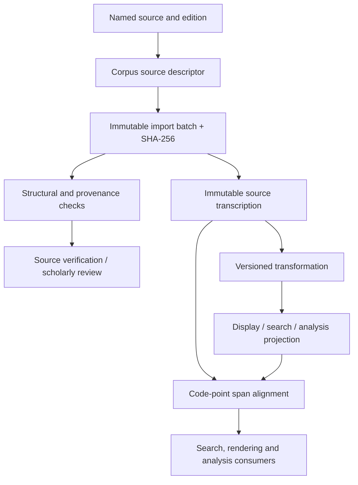

# QA1–QA2 — Corpus Provenance and Arabic Unicode Alignment

## Objective

Make imported Qur'anic text auditable and every display/search/analysis projection traceable to source spans without mutating source text.

This milestone introduces contracts only. It does not select a corpus provider, assert a license, bundle Qur'anic text, or declare any representation verified.

## QA1 — Source and import provenance

A source descriptor records:
- Stable source/provider identifier.
- Provider and source-work title.
- Exact edition identifier and release.
- Source URI when available.
- Declared license identifier and license URI.
- Declared redistribution posture.

An import batch records an immutable artifact SHA-256 digest, record count, import timestamp, importer version and verification state. SCHOLAR_REVIEWED requires an explicit reviewer reference.

Verification states are distinct:
1. RECEIVED — artifact accepted for processing.
2. STRUCTURALLY_VALIDATED — schema and structural checks passed.
3. SOURCE_VERIFIED — provenance checked against the named source.
4. SCHOLAR_REVIEWED — designated scholarly review recorded.
5. REJECTED — batch rejected.

A technical import or digest check must never be promoted automatically to scholarly verification. Redistribution metadata is a source declaration, not legal advice or a license grant.

## QA2 — Unicode and orthographic alignment

- Source transcription remains unchanged at the text-value boundary; no normalization is applied in place.
- Derived representations declare a UnicodeNormalizationPolicy.
- Alignment ranges are measured in Unicode code points, not Java UTF-16 char offsets.
- Each alignment segment maps a source span to a derived span.
- Segments must remain monotonic, non-overlapping and within both texts.
- Transformations that remove, combine or expand marks must emit explicit alignment data.
- Search normalization is a retrieval projection, never a replacement for attested text.

The policy deliberately does not hard-code a supposedly complete list of Uthmani marks. Later fixtures must be based on a named Unicode version and an identified, expert-reviewed text edition. Unicode NFC/NFD is not a substitute for Qur'anic orthographic validation.

## Architecture

## Dependency boundaries

- Contracts remain in kallam-language-arabic and use only the Java platform.
- Provider-specific importers, storage, hashing streams and Unicode transformation engines belong in adapters.
- The domain records the digest and transformation provenance; adapters calculate and verify the actual artifact digest.
- No provider, model, Quarkus, Andalus runtime or database dependency is introduced.

## Acceptance criteria

- Unknown or incomplete license posture is explicit rather than guessed.
- A source descriptor identifies its edition and release.
- Import batches require a SHA-256 digest and importer version.
- Scholar-reviewed batches require reviewer attribution.
- Code-point ranges reject out-of-bounds and non-monotonic alignment.
- Arabic source strings remain unchanged when a projection is created.
- Tests include supplementary-plane code points to prevent UTF-16 offset confusion.

## Deferred

- Provider-specific corpus importers and schema adapters.
- Named corpus and license selection after review.
- Unicode versioned mark inventory and curated Uthmani fixtures.
- Token/word-level alignment and many-to-many annotation graphs.
- Qira'at and riwayah registries with verified source attestations.
- Expert review workflow, signatures and approval policy.
