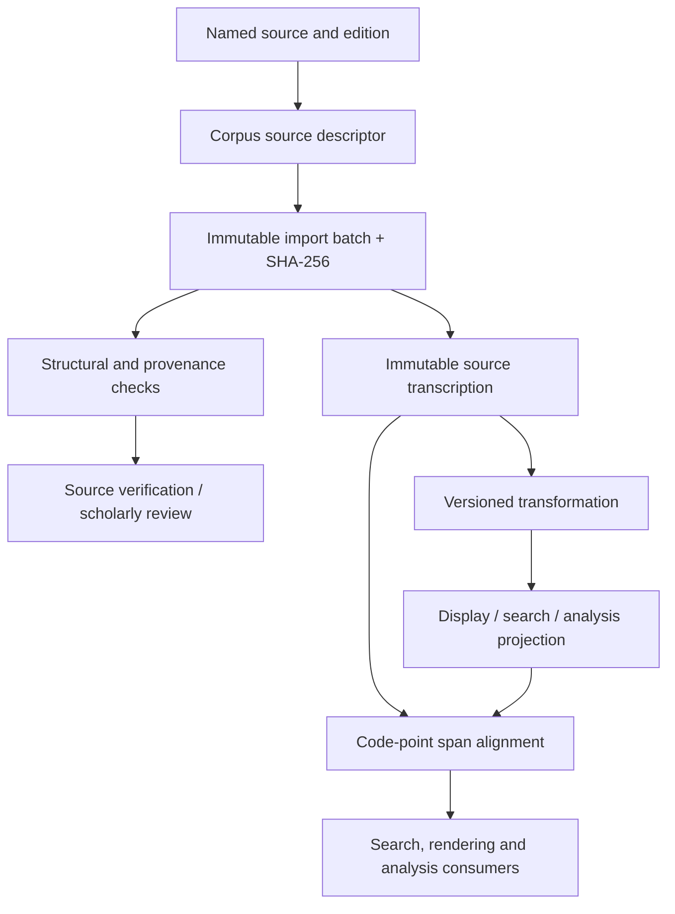

# QA1–QA2 — Qur'anic Corpus Provenance and Unicode Alignment

## Objective

Make imported Qur'anic text auditable and every display/search/analysis projection traceable to source spans without mutating source text. These contracts live in kallam-quran, not kallam-language-arabic.

## Source and import provenance

A source descriptor records stable provider identity, source-work title, exact edition and release, source URI, declared license and redistribution posture. An import batch records SHA-256 artifact digest, record count, timestamp, importer version and verification state. SCHOLAR_REVIEWED requires explicit reviewer attribution.

Technical import validation is distinct from source verification and scholarly review. Redistribution metadata is a source declaration, not legal advice or a license grant.

## Unicode and orthographic alignment

- Source transcription remains unchanged.
- Derived representations declare a UnicodeNormalizationPolicy.
- Alignment ranges use Unicode code points, not Java UTF-16 char offsets.
- Alignment segments are monotonic, non-overlapping and within both texts.
- Transformations that remove, combine or expand marks emit explicit alignment data.
- Search normalization is a retrieval projection, never a replacement for attested text.

The model does not hard-code a supposedly complete list of Uthmani marks. Later fixtures require a named Unicode version and identified, expert-reviewed edition. NFC/NFD is not a substitute for Qur'anic orthographic validation.

## Dependency boundaries

Contracts remain in kallam-quran and use only the Java platform. Provider-specific importers, storage, hashing streams and transformation engines belong in adapters. General Arabic analysis may consume Qur'anic text through explicit ports but does not own or mutate it.
