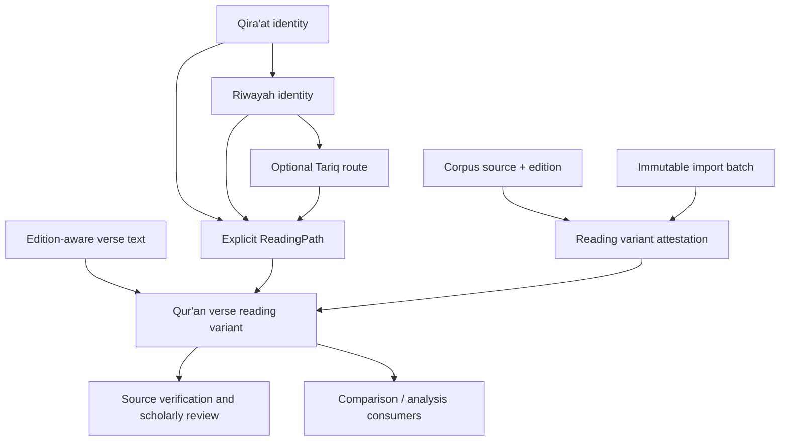

# QA3 — Qira'at, Riwayah and Transmission Foundation

## Objective

Introduce provider-independent domain contracts for identifying reading traditions and associating source-edition verse text with a declared transmission path. QA3 does not bundle reading data or make scholarly claims about the authenticity, ranking or canonical status of any reading.

## Identity model

The model keeps these concepts distinct:

- **Qira'at** — the reading tradition identity.
- **Riwayah** — a transmission associated with a Qira'at.
- **Tariq** — an optional route within a riwayah.
- **ReadingPath** — an explicit tuple of Qira'at, riwayah and optional tariq identifiers.

A riwayah identifier is not a Qira'at identifier. A tariq cannot be attached without its parent riwayah in the curated registry. The domain value object carries identifiers; registry adapters validate parent-child relationships against reviewed metadata.

## Verse-level variants and provenance

A QuranVerseReadingVariant combines:
1. An edition-aware QuranVerseText, retaining its exact source representation.
2. An explicit ReadingPath.
3. A ReadingVariantAttestation tying that verse and path to a corpus source, import batch and source locator.

Attestation states are intentionally separate:
- DECLARED — association entered but not independently checked.
- SOURCE_ATTESTED — source provenance checked against the named source.
- SCHOLAR_REVIEWED — designated review recorded with reviewer attribution.
- REJECTED — association rejected.

A parser, search result or model prediction must never promote a declaration to source-attested or scholar-reviewed. A text spelling or Unicode code point must never be used to infer a Qira'at or riwayah identity.

## Architecture

## Dependency boundaries

- Definitions, identifiers, variants, attestation values and registry ports live in kallam-language-arabic.
- Persistence, curated reading datasets, source verification and scholarly review workflows belong in adapters/application services.
- Registries must validate that each riwayah belongs to the declared Qira'at and each tariq belongs to the declared riwayah.
- The domain deliberately does not seed names or assume a closed list of readings.
- No Quarkus, Andalus, model provider, database or corpus dependency is introduced.

## Acceptance criteria

- Qira'at, riwayah and tariq have separate strongly typed identifiers.
- A reading path explicitly records the hierarchy and permits an unspecified tariq.
- Registry ports expose curated metadata without coupling the domain to storage.
- A verse variant must carry source-edition text and an attestation.
- Attestation verse and reading path must match the variant exactly.
- Scholar-reviewed status requires reviewer attribution.
- Tests prove mismatched verse/path attestations are rejected.

## Deferred

- Curated Qira'at, riwayah and tariq catalogues with qualified scholarly review.
- Named source editions, source locators and license verification.
- Rules for variant grouping, word/token alignment and cross-riwayah comparison.
- Tajwid, waqf/ibtida', orthographic and phonological annotation schemas.
- Morphology and syntax annotations; these belong to the shared Arabic engine and should consume these stable source contracts.
