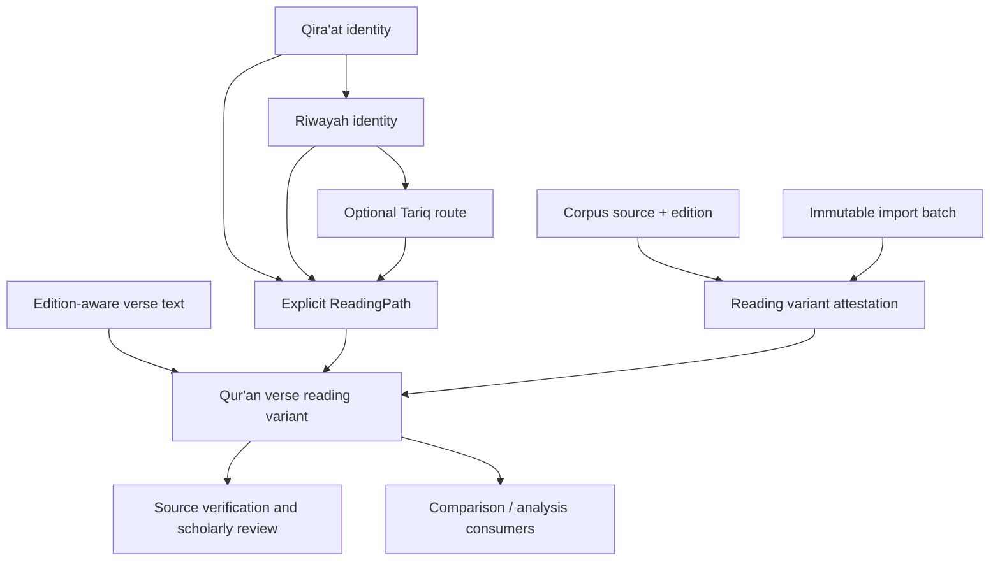

# QA3 — Qira'at, Riwayah and Transmission Foundation

## Objective

Introduce provider-independent domain contracts for identifying reading traditions and associating source-edition verse text with a declared transmission path. QA3 does not bundle reading data or make scholarly claims about authenticity, ranking or canonical status.

## Identity model

- Qira'at — the reading tradition identity.
- Riwayah — a transmission associated with a Qira'at.
- Tariq — an optional route within a riwayah.
- ReadingPath — an explicit tuple of Qira'at, riwayah and optional tariq identifiers.

A riwayah identifier is not a Qira'at identifier. A tariq cannot be attached without its parent riwayah in the curated registry. Registry adapters validate parent-child relationships against reviewed metadata.

## Verse-level variants and provenance

A QuranVerseReadingVariant combines edition-aware QuranVerseText, an explicit ReadingPath and a ReadingVariantAttestation tying that verse/path to a corpus source, import batch and source locator.

Attestation states remain distinct:
- DECLARED — association entered but not independently checked.
- SOURCE_ATTESTED — source provenance checked against the named source.
- SCHOLAR_REVIEWED — designated review recorded with reviewer attribution.
- REJECTED — association rejected.

A parser, search result or model prediction must never promote a declaration to source-attested or scholar-reviewed. Text spelling or Unicode code points must never be used to infer Qira'at or riwayah identity.

## Dependency boundaries

Definitions, identifiers, variants, attestation values and registry ports live in the independent kallam-quran module. General Arabic linguistic analysis lives in kallam-language-arabic and consumes source-aware Qur'anic contracts through explicit integration ports. Persistence, curated reading datasets, source verification and scholarly review workflows belong in adapters/application services.

## Acceptance criteria

- Qira'at, riwayah and tariq have separate strongly typed identifiers.
- A reading path explicitly records the hierarchy and permits an unspecified tariq.
- Registry ports expose curated metadata without coupling the domain to storage.
- A verse variant carries source-edition text and an attestation.
- Attestation verse and reading path match the variant exactly.
- Scholar-reviewed status requires reviewer attribution.
- Tests reject mismatched verse/path attestations.

## Deferred

Curated catalogues, named source editions and license verification, variant grouping and cross-riwayah comparison, Tajwid, waqf/ibtida', orthographic and phonological annotation schemas, and morphology/syntax annotations.
