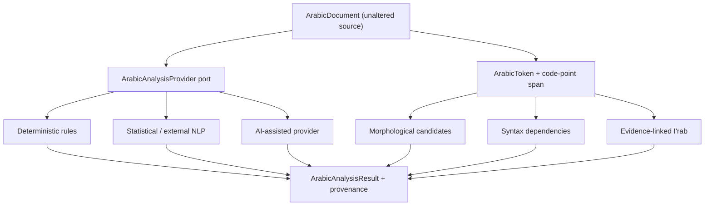

# QA4 — Arabic Linguistic Analysis Foundation

## Objective
Create reusable, provider-independent Arabic linguistic contracts shared by Qur'anic, Hadith and classical-text workflows. Source-specific editions and scholarly traditions remain in their owning modules.

## Scope
- Source-preserving Arabic documents, token annotations and Unicode code-point spans.
- Candidate morphology: lemma, root, pattern, morphemes, features and provider score.
- Syntax dependency relations with an explicitly named relation framework.
- I'rab annotations with grammatical role, optional case/mood, governing element, evidence references and provenance.
- A provider port for deterministic rules, statistical NLP and AI-assisted engines.
- Multi-candidate results; competing analyses are not silently collapsed or ranked.

## Architecture

## Invariants
1. Original source is retained; normalized/search text is a separate projection.
2. Offsets are half-open Unicode code-point ranges, not UTF-16 indices.
3. Token surface must equal the exact source substring.
4. Morphological ambiguity is first-class and multiple candidates may coexist.
5. Syntax labels declare their framework; no universal tagset is assumed.
6. I'rab is an evidence-linked annotation, not a bare POS/case label.
7. Provider scores are not scholarly certainty.
8. Provider identity, version and method are disclosed.
9. No corpus, curated lexicon, grammar-school ranking or vendor dependency is introduced.
10. No Quarkus, Andalus, persistence or model-vendor dependency enters the domain module.

## Deferred
Algorithms, reviewed root/lemma lexicon, Naḥw constituency trees, framework mappings, semantics, Balaghah, context/discourse analysis, gold datasets and concrete runtime adapters.
