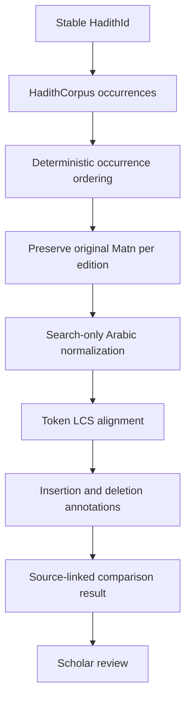

# H3 — Matn Variant Comparison

## Purpose

H3 compares source-attested Matn occurrences already linked to one stable `HadithId`. It makes wording differences inspectable while keeping the exact source text and its edition provenance intact.

## Flow

## Output semantics

- Every variant retains occurrence, collection, edition, locator and exact original Matn.
- The normalized Matn is a disposable comparison projection, never a replacement for source text.
- The first occurrence by stable occurrence ID is the deterministic baseline. It is a comparison anchor only, not a preferred, canonical or authoritative recension.
- Differences are token-level insertions/deletions after normalization. Orthographic/diacritic differences removed by normalization remain visible in each original text but do not appear as lexical differences.
- The implementation bounds each normalized Matn to 512 tokens to keep the quadratic LCS alignment bounded. Results disclose truncation.
- This version compares occurrences already assigned the same HadithId. It does not infer that two unrelated narrations are identical.

## Method and limits

The alignment uses longest common subsequence (LCS) over whitespace-delimited normalized tokens. It is deterministic and explainable, suitable as a first scholar-facing comparison aid. It is not a linguistic model, isnad analysis, grading method, authenticity decision, or proof of textual relationship. LCS is quadratic in token count; the 512-token cap is a safety boundary, not a scholarly rule.

The current adapter uses the existing `HadithCorpus.findOccurrences` port and requires no framework, database, or runtime dependency. A future persistence adapter can optimize retrieval without changing this application service.

## Review boundary

Scholars must inspect the original source editions, manuscript/print witnesses, editorial conventions and surrounding context. No source is ranked as more authoritative by this comparison service.
