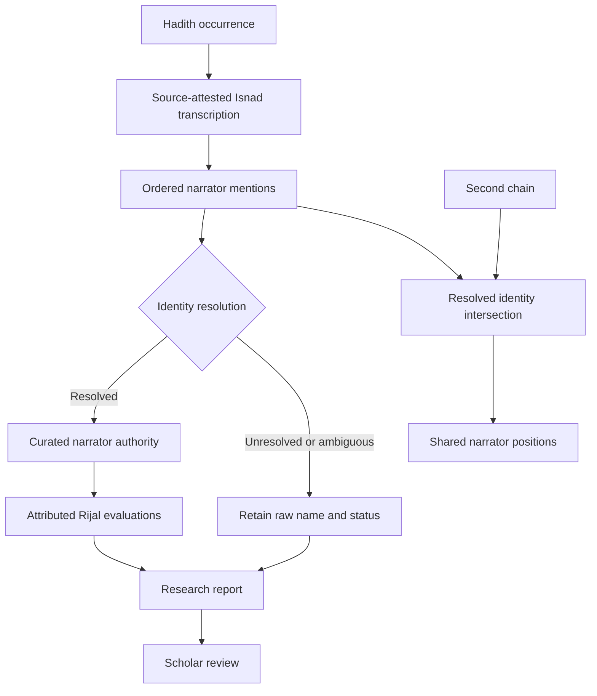

# H4 — Isnad and Rijal Research

## Purpose

H4 introduces source-linked Isnad transcription, explicit narrator identity resolution, attributed Rijal evaluations and chain intersection. It supports inspection without issuing automatic continuity, narrator reliability or Hadith authenticity rulings.

## Domain flow

## Included capabilities

- `Narrator` and `NarratorId` represent curated authority records. An Isnad link retains its exact transcribed narrator mention.
- Each link has an explicit resolution state: `RESOLVED`, `UNRESOLVED`, `AMBIGUOUS` or `NOT_ASSESSED`. Only resolved links carry a narrator ID.
- `IsnadChain` preserves its original chain transcription, occurrence identity and source locator. Link positions are ordered; missing positions remain representable.
- `NarratorEvaluation` preserves evaluator, cited source, original judgment wording, methodology, date and notes. Conflicting judgments remain separate records.
- `IsnadResearchService.inspect` reports unresolved mentions, ambiguous/unassessed positions, gaps in recorded positions and attributed evaluations.
- `IsnadResearchService.compare` identifies shared resolved narrator IDs across two chains and records their positions.

## Interpretation boundaries

A missing numbered position is a data/transcription diagnostic, not proof of a broken chain. A narrator identity match is only as reliable as the curated resolution behind it. Shared narrators do not prove that two chains are mutually corroborating or independent. Evaluations are never averaged or reduced to a single reliability score. Absence of an evaluation is not a positive or negative judgment.

This milestone does not yet implement chronology-based meeting possibility, narrator travel/geography, teacher-student relationship verification, tadlis analysis, hidden defects (\'ilal), or automatic chain grading. Those require carefully sourced biographical and historical datasets plus explicit methodological profiles and scholarly review.

## Ports and runtime

`IsnadResearchRepository` is a framework-independent read port. Database, corpus, REST, MCP and Andalus integrations belong in adapters. The domain and application service have no Quarkus or Andalus dependency.
