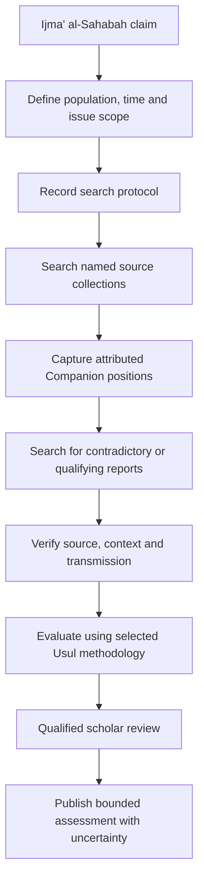

# U1 — Companion Consensus Research Protocol

## Objective

Make claims about ijma' al-Sahabah auditable as bounded historical research. U1 builds on the U0 claim, evidence, individual-position and methodology contracts.

## New contract

`ConsensusSearchProtocol` records:

- named source collections searched;
- temporal and optional geographic boundaries;
- inclusion and exclusion criteria;
- search expressions;
- coverage category (named collections, bounded bibliography, curated corpus or open-ended discovery);
- execution status, completion timestamp and execution reference.

This is a record of what was searched, not a certification that the selected sources are exhaustive or that consensus exists.

## Non-negotiable epistemic rules

1. A completed search means only that the declared protocol ran to completion.
2. `DISSENT_NOT_IDENTIFIED_WITHIN_SCOPE` remains bounded by the recorded protocol.
3. Absence of a dissent report in selected sources is not proof of historical unanimity.
4. An individual Companion position must retain its own source locator and verification state.
5. Later juristic agreement must not be back-projected as Companion consensus without early, attributable evidence.
6. A search engine, language model or retrieval score cannot promote a report to source-verified or scholar-reviewed.
7. Methodology-specific legal assessment remains distinct from historical source research.

## Research workflow

## Acceptance criteria

- Completed protocols require source collection IDs, search expressions, timestamp and execution reference.
- Unfinished protocols cannot carry a completion timestamp.
- Duplicate source IDs and search expressions are normalized without losing order.
- Tests explicitly assert that a completed bounded search does not imply exhaustive coverage.
- No historical consensus dataset or unreviewed Companion-position assertion is bundled.
