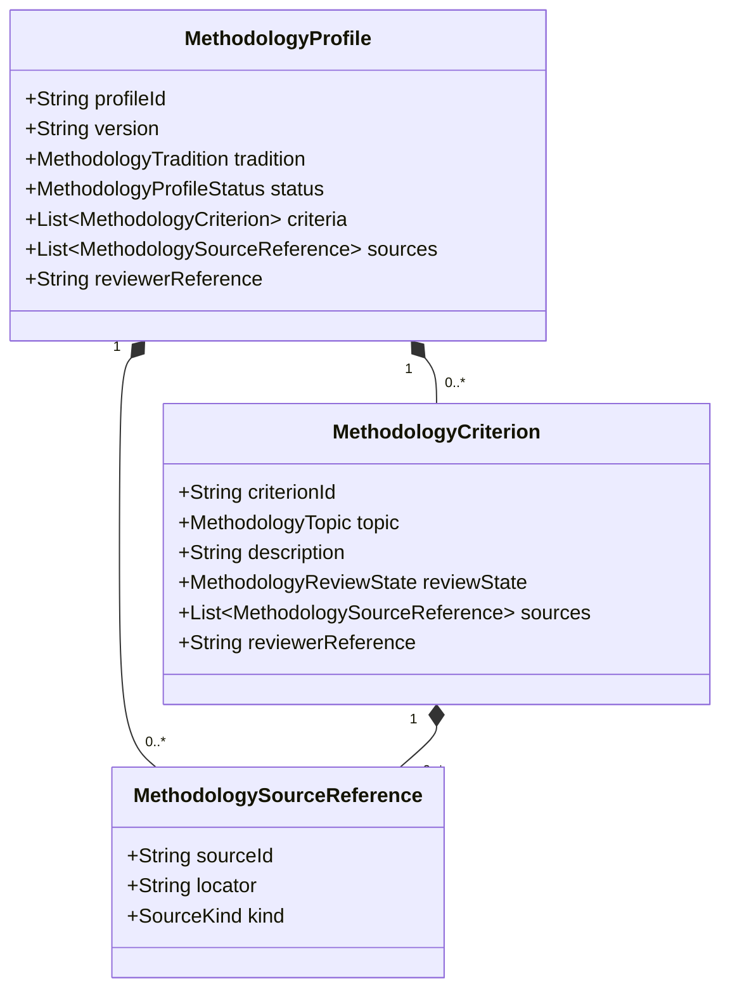
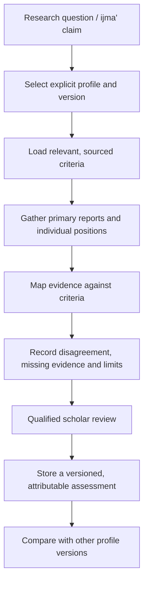

# U1 — Versioned Usul Methodology Profiles

## Objective

Provide an explicit, versioned way to describe criteria used when researching ijma', ijma' al-Sahabah and other Usul questions. Claims can reference a profile, and profiles can be compared without flattening their differences.

## Design principles

1. **No universal default madhhab.** Identify the methodology profile when methodology materially affects an assessment.
2. **Tradition labels are not consensus assertions.** Hanafi, Maliki, Shafi'i, Hanbali, Ja'fari, Zahiri, comparative and custom labels are supported. A label does not imply that all authorities in a tradition held one view.
3. **Version every profile.** A change to a criterion creates a new profile version so past assessments remain reproducible.
4. **Separate description from judgment.** A criterion is a sourced description for scholarly research, not executable fiqh or an autonomous verdict.
5. **Make review visible.** Draft material remains draft. Reviewed criteria require source locators and a reviewer; reviewed/published profiles require profile sources and reviewer attribution.
6. **Do not fabricate school rules.** The implementation provides contracts only. It does not preload substantive claims about any madhhab.

## Domain model

- MethodologyProfile: stable identifier, version, tradition, description, lifecycle, criteria, sources and reviewer.
- MethodologyCriterion: topic, descriptive text, review state, source references and reviewer.
- MethodologySourceReference: stable source identifier, precise locator and source kind.
- MethodologyTopic: initial topics for sarih/sukuti ijma', participant qualification, dissent search, transmission, chronology, geographic scope and qiyas.

## Assessment flow

## What this milestone does not do

- It does not assert that a school has one invariant position across all periods or authorities.
- It does not infer a criterion from an LLM response.
- It does not decide whether a claim is qat'i, zanni, binding or legally operative.
- It does not turn absence of located dissent into proof of historical unanimity.
- It does not publish a profile merely because a profile object exists.

## Next increments

- Add profile registry and immutable profile-version resolution.
- Link IjmaClaim methodology references to a resolvable profile/version.
- Add explicit criterion applicability and evidence-mapping records.
- Add ikhtilaf and qiyas research models that consume profiles without duplicating them.
- Populate real profiles only from reviewed primary and scholarly sources under qualified editorial review.
