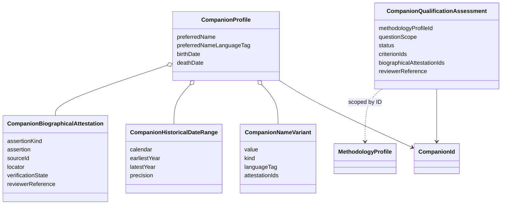
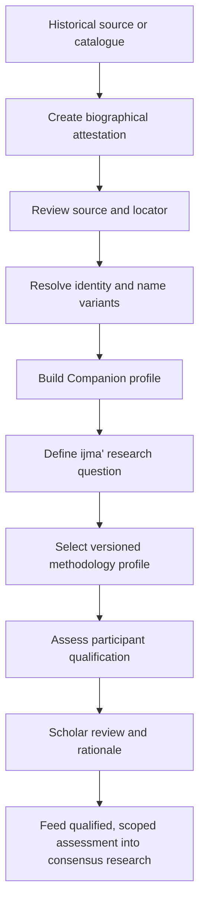

# U2 — Companion identity, chronology and qualification registry

## Purpose

U2 introduces the data contracts needed to represent a Companion's historical identity without turning an identity catalogue into a legal-authority ranking. It is a foundation for later sourced biographical ingestion and methodology-aware ijma' research.

## Domain separation

- **Identity** — `CompanionProfile` and the existing stable `CompanionId`.
- **Name forms** — `CompanionNameVariant` records ism, kunya, nasab, nisbah, laqab and other forms, with attestation identifiers.
- **Historical chronology** — `CompanionHistoricalDateRange` preserves calendar system, uncertain boundaries and precision. It intentionally does not convert AH to CE or pretend year-only data is a full date.
- **Biographical evidence** — `CompanionBiographicalAttestation` stores an assertion, source locator, verification state and reviewer attribution.
- **Methodological qualification** — `CompanionQualificationAssessment` is scoped to a methodology profile and a specific research question. It is not a property on the identity profile.

## Model

## Research flow

## Epistemic and data-integrity rules

1. A profile records an identity candidate; it does not declare universal rank, reliability, juristic competence or eligibility for every ijma' inquiry.
2. A name variant is not automatically an identity match. Every variant can retain links to source attestations; identity resolution remains reviewable.
3. Dates are uncertain historical intervals, not falsely precise timestamps. Hijri and CE year values remain in their own calendar systems; no implicit conversion is performed.
4. Biographical assertions must retain a source ID and locator. `SOURCE_LOCATED` is not the same as `SOURCE_VERIFIED`, and scholar review requires reviewer attribution.
5. Qualification is scoped to a methodology profile and question. A conclusion requires explicit criteria, supporting biographical attestations, reviewer attribution and rationale.
6. `NOT_ASSESSED` is a valid state. Missing evidence must never be interpreted as disqualification or qualification.
7. No pre-populated historical dataset is introduced in this milestone. Future ingestion must select editions, establish source rights, retain variant readings and undergo qualified review.
8. Neither retrieval ranking nor an AI-generated biography can promote an attestation or qualification status.

## Acceptance criteria

- Stable `CompanionId` is reused; no parallel identity key is introduced.
- Identity, name forms, chronology, source assertions and qualification are separate concepts.
- Uncertain and unknown chronology can be represented without invented precision.
- Concluded qualification assessments cannot exist without methodology, scope, criteria, evidence references, reviewer and rationale.
- The model remains neutral across scholarly traditions and does not declare Companion consensus.

## Deferred

- Historical biographical datasets and authority lists.
- Automated identity resolution across variant spellings and kunyas.
- AH/CE conversion services and detailed date-calendaring.
- Madhhab-specific qualification rules and any automated eligibility decision.
- Source ingestion, edition licensing and scholarly adjudication workflows.
