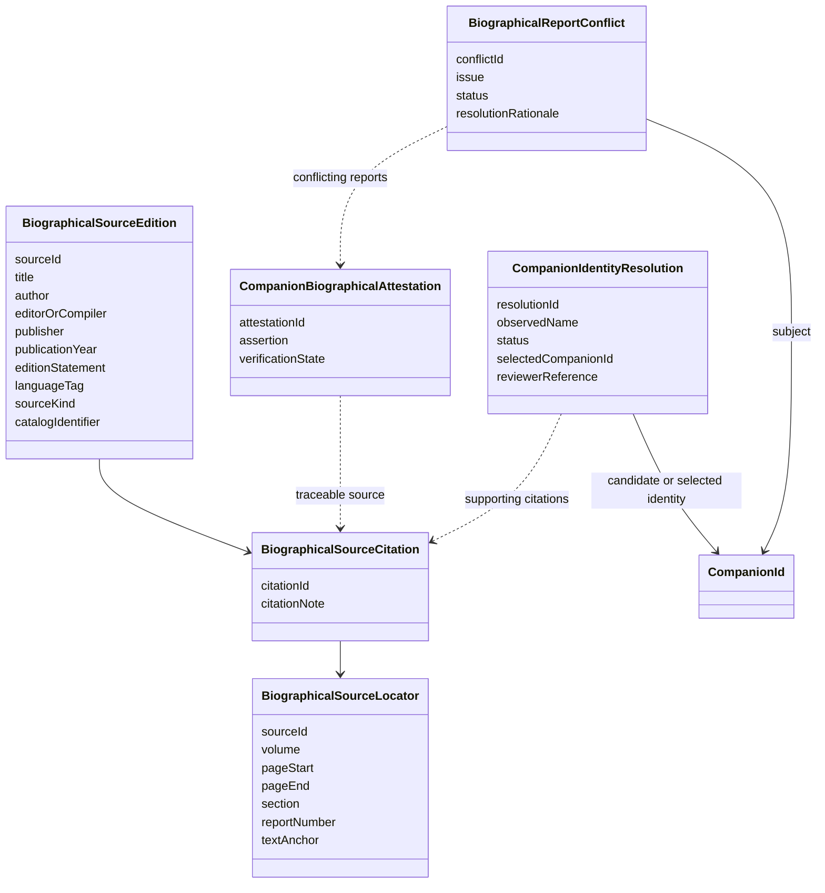
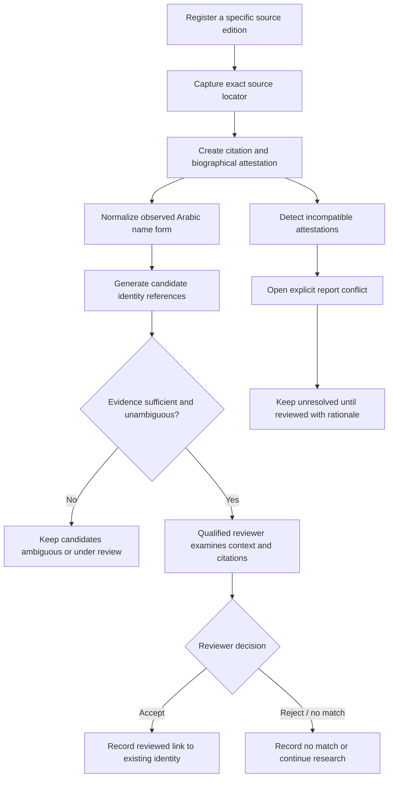

# U3 — Biographical source registration and identity resolution

## Purpose

U3 makes Companion biographical research traceable at edition and locator level. It adds source-edition registration contracts, structured citations, reviewable name-to-identity resolution and explicit handling of conflicting reports.

This is a domain foundation, not a scraper, OCR pipeline, automatic authority classifier or pre-populated biographical database.

## Domain model

## Resolution workflow

## Rules

1. **Edition identity matters.** A title alone is insufficient. Register the edition, author/editor where known, publication metadata, language and catalogue identifier where available. Do not silently combine pagination across editions.
2. **Locators are edition-specific.** A citation locator must refer to the same registered `sourceId` as its edition. Volume, pages, section, report number or digital text anchor may be used; a locator with no anchor is invalid.
3. **Citations are not verdicts.** A citation identifies where an assertion can be checked. It does not itself verify authenticity, authorship, transmission or historical truth.
4. **Name matching proposes candidates.** Arabic normalization and lexical similarity may assist retrieval, but must not merge identities or convert a common kunya/nasab into a unique person.
5. **Accepted identity links require human review.** An accepted match must cite supporting references and preserve reviewer attribution and rationale. Candidate identities remain stable records; this milestone does not merge or delete them.
6. **Ambiguity is a first-class outcome.** Multiple candidates remain explicit; no arbitrary top-ranked candidate becomes the selected person.
7. **Conflicting reports remain visible.** At least two distinct attestations are required to register a conflict. Resolution requires reviewer attribution and an explanation; unresolved conflict is a valid state.
8. **No fabricated source metadata.** Unknown bibliographic fields remain absent. No source content or historical person records are seeded by this milestone.
9. **No automated grading.** Retrieval, OCR confidence, transliteration similarity or model confidence cannot promote a citation, attestation, identity match or conflict resolution.

## Acceptance criteria

- Citations bind to one explicit edition and a usable locator.
- Identity resolution preserves candidate identities and has an explicit ambiguous state.
- An accepted identity match requires citations, reviewer and rationale.
- Conflicts can be recorded without forcing a winner.
- A conflict cannot be marked resolved without reviewer attribution and rationale.
- Existing `CompanionId`, profile, attestation and qualification contracts remain the stable foundation.

## Deferred

- Edition catalogues and source licensing / rights workflows.
- Arabic script normalization, transliteration and fuzzy retrieval services.
- OCR, ingestion connectors, text extraction and source alignment.
- Historical name authority dataset and human adjudication UI.
- Automatic conflict detection; conflict registration remains an explicit reviewed research action.
